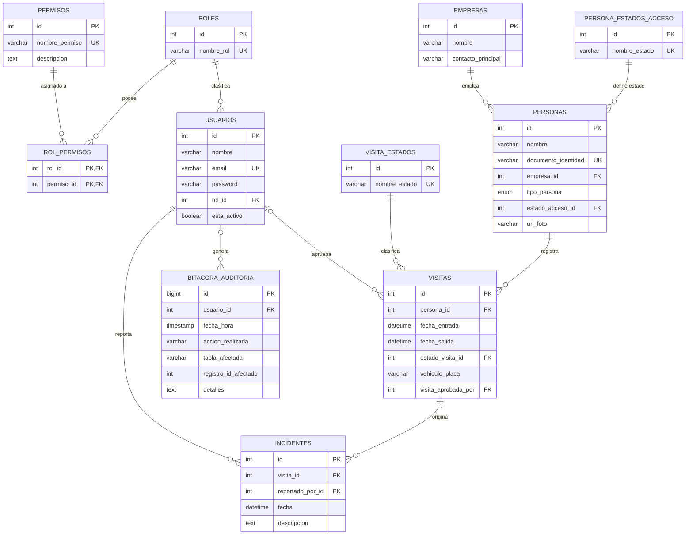

# SICA — Sistema Integrado de Control de Acceso para Zona Acme

## 1. Introducción

**Zona Acme** es un complejo empresarial con más de 30 empresas. Su control de acceso se apoyaba en libros de registro en papel y radio: no se sabía quién estaba dentro en un momento dado, las visitas no anunciadas bloqueaban la recepción y reconstruir un incidente era una tarea manual e imprecisa.

**SICA** sustituye ese proceso por una aplicación de escritorio que centraliza:

- Registro de personas, empresas, usuarios y roles con **RBAC dinámico** leído desde MySQL.
- **Cuatro flujos de acceso** (pre-registrado, no anunciado, carnet olvidado y salida olvidada) con aprobaciones **en tiempo real** entre ventanas independientes.
- **Bitácora de auditoría inmutable** de cada operación crítica.
- Reportes de "quién está dentro", historial de visitas e incidentes.

### Stack tecnológico

| Capa | Tecnología | Uso en SICA |
|---|---|---|
| Lenguaje | **Java SE 17** | Sin Spring ni frameworks pesados; Streams, lambdas, records y `ScheduledExecutorService`. |
| UI | **Swing + FlatLaf 3.5.4** | Look & Feel moderno: botones redondeados, tablas limpias, tema claro/oscuro. |
| Seguridad | **jbcrypt 0.4** | Hash BCrypt (coste 10) de contraseñas con salt automático. |
| Persistencia | **MySQL Connector/J 8.4.0** | JDBC directo, `PreparedStatement` y transacciones. |
| Base de datos | **MySQL 8.0 + phpMyAdmin** | Docker Compose, volumen persistente y carga automática de SQL. |
| Build | **Maven 3.9+** | `pom.xml`, perfiles de compilación, ejecución y pruebas. |
| Pruebas | **JUnit Jupiter 5.10.2** | 15 pruebas unitarias de reglas de negocio (`scope test`). |

> No hay ORM, IOC ni "magia": las dependencias se inyectan a mano en `ServiceLocator`.

> **Codificación:** todos los archivos de texto del repositorio están en **UTF‑8 sin BOM** y con saltos de línea `LF` (ver `.gitattributes`). El README original del proyecto era UTF‑16LE; se normalizó para que Git lo trate como texto y los diffs sean legibles.

---

## 2. Arquitectura del proyecto

### 2.1 Árbol de directorios

```
project-sica/
├── pom.xml                       # Java 17, dependencias y plugins (jar / exec / surefire)
├── docker-compose.yml            # MySQL 8.0 + phpMyAdmin + volumen persistente
├── db/
│   ├── schema.sql                # 11 tablas del PDF + índices de apoyo
│   └── data.sql                  # Permisos, roles, 4 usuarios, looks y visitas de prueba
├── src/main/
│   ├── resources/
│   │   └── application.properties # URL JDBC, credenciales y seconds de refresco
│   └── java/com/zonaacme/sica/
│       ├── SicaApplication.java   # main(): instala FlatLaf, prueba BD, abre LoginFrame
│       ├── config/                # AppSettings, DatabaseConfig (Singleton), ServiceLocator
│       ├── model/
│       │   ├── entity/            # Usuario, Rol, Permiso, Persona, Empresa, Visita,
│       │   │                      # Incidente, BitacoraAuditoria, Sesion
│       │   └── enums/             # EstadoVisita, EstadoAcceso, TipoPersona,
│       │                          # TipoFlujoVisita, AccionAuditoria
│       ├── dao/                   # Contratos + BaseDao, RowMapper, TransactionRunner
│       │   └── impl/              # Implementaciones JDBC (una por entidad)
│       ├── service/               # Interfaces de negocio (una por caso de uso)
│       │   └── impl/              # Reglas RBAC, auditoría, flujos y transacciones
│       ├── pattern/               # factory/, observer/, strategy/ (los 3 patrones de comportamiento)
│       ├── controller/            # SicaController (fachada) y NavegacionController
│       ├── view/                  # LoginFrame, MainFrame
│       │   ├── components/        # UiTheme, BasePanel, GenericTableModel, EstadoRenderer, Formularios
│       │   └── panels/            # ControlAcceso, Personas, Empresas, Usuarios, Incidentes, Reportes
│       ├── util/                  # PasswordHasher, ValidationUtil, DateUtil
│       └── exception/             # SicaException + AccesoDenegado, Validacion, Persistence
└── src/test/java/com/zonaacme/sica/  # Pruebas JUnit de estrategias, factory, RBAC y hash
```

### 2.2 Flujo de comunicación entre capas

```
Clic en Swing (view/panels/*)
        │  solo eventos y componentes; sin SQL ni reglas de negocio
        ▼
SicaController.ejecutar(Accion)  (controller)
        │  traduce excepciones a Resultado(ok, mensaje)
        ▼
XxxServiceImpl  (service)
        ├── sesion.requerir("permiso")          → RBAC en servidor
        ├── IngresoStrategyResolver / VisitaFactory / VisitaEventBus
        ├── AuditoriaService.registrar(...)     → bitácora
        ▼
XxxDao (interfaz) → XxxDaoJdbc extends BaseDao (dao)
        │  PreparedStatement + try-with-resources
        ▼
DatabaseConfig (Singleton) → DriverManager → MySQL 8.0 (Docker)
```

**Regla MVC:** la vista nunca escribe SQL. Llama al controlador, recibe un `Resultado` y muestra un `JOptionPane`. La lógica de negocio vive en `service`, y el acceso a datos en `dao`.

### 2.3 Actualización en tiempo real (multi-ventana)

1. `ServiceLocator` es un Singleton que crea **una sola** instancia de `VisitaEventBus` y la comparte entre todas las ventanas.
2. Cada `BasePanel` se suscribe al bus en `addNotify()` y se desuscribe en `removeNotify()`.
3. Cuando un servicio aprueba, rechaza, hace check-in/out o regulariza una salida, llama a `eventos.notificar(tipo, mensaje)`.
4. `VisitaEventBus.notificar()` usa `CopyOnWriteArrayList` y envía cada callback al **EDT** con `SwingUtilities.invokeLater`; el panel vuelve a consultar la BD y repinta su tabla.
5. Además, `BasePanel` programa un `ScheduledExecutorService` con `AppSettings.refreshSeconds()` (2 s por defecto) como red de seguridad si una ventana se abre después del cambio.

**Resultado:** se pueden abrir dos sesiones con el botón **"＋ Nueva ventana"** (Guarda y Funcionario) y ver la aprobación del Funcionario reflejada en la bandeja del Guarda sin reiniciar.

---

## 3. Modelo de base de datos

### 3.1 Diagrama Entidad-Relación (Mermaid)



### 3.2 Grupos de tablas

| Grupo | Tablas | Propósito |
|---|---|---|
| **RBAC** | `roles`, `permisos`, `rol_permisos`, `usuarios` | Los 25 permisos viven en la BD. Al hacer login se cargan los nombres del rol y se guardan en `Sesion`; la UI muestra solo módulos permitidos y el servicio vuelve a validar con `sesion.requerir(...)`. |
| **Lookups** | `persona_estados_acceso`, `visita_estados` | Catálogos de estados. Además de los estados del PDF se añaden los ids 7 y 8 (`Pendiente de Aprobacion por Olvido`, `Cerrada por Sistema (Salida Olvidada)`) que exigen los flujos 3 y 4; el propio documento indica "etc.". |
| **Operacionales** | `empresas`, `personas`, `visitas`, `incidentes` | Personas (trabajadores/invitados), visitas con su estado y trazabilidad de aprobación, e incidentes asociados a una visita. |
| **Auditoría** | `bitacora_auditoria` | Solo INSERT desde servicios y SELECT desde la UI. Registra quién, cuándo, qué acción, tabla, registro y detalle. No hay UPDATE/DELETE en el código: es inmutable por diseño. |

> El esquema respeta columnas y relaciones del documento; los índices (`idx_visitas_persona`, `idx_visitas_estado`, `idx_bitacora_fecha`, …) son apoyo de consulta y no alteran el modelo.

---

## 4. Decisiones de diseño: SOLID y patrones

### 4.1 Principios SOLID

| Principio | Dónde está | Por qué se decidió así |
|---|---|---|
| **SRP** — Responsabilidad única | `VisitaServiceImpl`, `AppSettings`, `BaseDao`, `VisitaEventBus` | Cada clase hace una sola cosa: orquestar accesos, leer configuración, ejecutar JDBC o notificar eventos. Un cambio en el tema visual no toca la lógica de visitas. |
| **OCP** — Abierto/Cerrado | `IngresoStrategyResolver` + `IngresoStrategy`; `VisitaFactory` | Un nuevo flujo se agrega como nueva estrategia/entrada del mapa sin modificar el servicio. El servicio solo conoce al resolvedor. |
| **LSP** — Sustitución de Liskov | `UsuarioDao` → `UsuarioDaoJdbc`, `VisitaSubject` → `VisitaEventBus` | Cualquier implementación del contrato puede sustituirse sin cambiar los servicios que la consumen. |
| **ISP** — Segregación de interfaces | `VisitaObserver`, `RowMapper`, `Accion`, servicios separados (`AuthService`, `AuditoriaService`, …) | Interfaces pequeñas: un panel solo implementa `onVisitasActualizadas`, no todos los eventos posibles. |
| **DIP** — Inversión de dependencias | Servicios → interfaces DAO; `ServiceLocator` inyecta las implementaciones | La capa de negocio no importa `*.dao.impl`; depende de abstracciones. `ServiceLocator` es el único lugar que "sabe" qué implementación se usa. |

### 4.2 Los 5 patrones clásicos (exactamente)

| # | Patrón | Clases participantes | Problema que resuelve en SICA |
|---|---|---|---|
| 1 | **Singleton** | `DatabaseConfig` (holder thread-safe) y `ServiceLocator` (composition root) | Un único punto de configuración JDBC y un único `VisitaEventBus` compartido por todas las ventanas. *`ServiceLocator` no cuenta como patrón nuevo: es otra aplicación del mismo Singleton.* |
| 2 | **DAO** | `BaseDao`, `RowMapper`, interfaces `XxxDao` y sus `XxxDaoJdbc` | Aísla JDBC (try-with-resources, parámetros, transacciones) del negocio y permite sustituir la persistencia sin tocar los servicios. |
| 3 | **Factory** | `VisitaFactory` + `TipoFlujoVisita` | Centraliza la creación de `Visita` según el flujo, asignando estado inicial, aprobador y fecha de entrada. Evita `if/else` repartidos por el servicio. |
| 4 | **Observer** | `VisitaSubject`, `VisitaObserver`, `VisitaEventBus`, `BasePanel` | La aprobación del Funcionario actualiza al instante la bandeja del Guarda, sin polling manual ni reinicio. Los callbacks se entregan en el EDT de Swing. |
| 5 | **Strategy** | `IngresoStrategy`, 5 estrategias concretas, `IngresoStrategyResolver`, `SolicitudIngreso`, `ResultadoIngreso` | Encapsula cada regla (bloqueado, salida olvidada, pre-registrado, no anunciado, carnet olvidado) y las aplica en orden de prioridad con un `stream().map(...).filter(...).findFirst()`. |

> **Nota de sustentación:** los 5 patrones están etiquetados en el Javadoc de las clases. `ServiceLocator` es intencionalmente el mismo Singleton #1, para no introducir un sexto patrón.

---

## 5. Instalación y ejecución desde cero (para cualquier computador)

Esta sección está escrita **paso a paso, desde cero**, para que funcione tanto en tu PC como en la del profesor. No se asume que sabes instalar nada. Si un paso te parece obvio, igual léelo: el orden importa.

### 5.0 Entender qué vamos a hacer (antes de tocar nada)

SICA son **dos piezas separadas**:

| Pieza | Qué es | Quién la levanta |
|---|---|---|
| La **base de datos** (MySQL) | El "archivo" donde se guardan personas, visitas, roles y auditoría. | Docker (`docker compose up -d`) |
| El **programa** (Java) | Las ventanas que ves y con las que trabajas. | Maven (`mvn exec:java`) |

**Docker no abre el programa.** Docker solo enciende MySQL y phpMyAdmin. El programa se abre después con Maven. Esta es la confusión más común.

Necesitamos instalar **3 herramientas**:

1. **Java 17** = el motor que entiende el código.
2. **Maven** = el ayudante que junta las piezas y ejecuta el programa.
3. **Docker Desktop** = la lonchera que enciende MySQL y phpMyAdmin.

Y necesitamos **la carpeta del proyecto** (el código).

> **Concepto útil - ¿qué es el PATH?**
> El PATH es una lista de carpetas que Windows revisa cuando escribes un comando. Si escribes `mvn` y la carpeta de Maven no está en esa lista, Windows dice "no se reconoce como nombre de un cmdlet...". Por eso en el paso 5.3 agregamos Maven al PATH y por eso hay que **abrir una terminal nueva** después.

> **Concepto útil - ¿qué es un puerto?**
> Es el número de "puerta" de un programa. MySQL de Docker entra por la puerta **3307** y phpMyAdmin por la **8081**. Usamos 3307 (y no 3306) porque muchos PCs tienen un MySQL local ocupando 3306. Esto funciona igual en tu PC que en otra.

---

### 5.1 Paso 1: Instalar Java 17 (JDK)

1. Abre el navegador y entra a `https://adoptium.net/`.
2. Descarga **Temurin JDK 17** para Windows (instalador `.msi`, arquitectura x64).
3. Abre el archivo descargado y haz clic en **Next** hasta terminar. Deja todas las opciones por defecto.
4. Cuando termine, **cierra y abre una terminal nueva** (PowerShell o CMD).
5. Escribe y pulsa Enter:

```powershell
java -version
```

6. Debe aparecer algo como:

```text
openjdk version "17.0.21" ...
```

Si aparece `java version "1.8..."` u otra versión, reinstala el JDK 17 y asegúrate de elegir esa versión.

---

### 5.2 Paso 2: Instalar Maven

1. Descarga `apache-maven-3.9.9-bin.zip` desde `https://maven.apache.org/download.cgi`.
2. Crea la carpeta `C:\Users\TU_USUARIO\tools` (cambia `TU_USUARIO` por tu nombre de usuario de Windows).
3. Abre el ZIP y arrastra la carpeta `apache-maven-3.9.9` dentro de `C:\Users\TU_USUARIO\tools`.
4. Debes tener este archivo: `C:\Users\TU_USUARIO\tools\apache-maven-3.9.9\bin\mvn.cmd`.
5. Agregar Maven al PATH (para poder escribir solo `mvn`):

   a. Presiona la tecla Windows y escribe **"variables de entorno"**.
   b. Abre **"Editar las variables de entorno del sistema"**.
   c. En la sección **Variables de usuario**, busca `Path` y haz clic en **Editar**.
   d. Clic en **Nueva** y pega:

```text
C:\Users\TU_USUARIO\tools\apache-maven-3.9.9\bin
```

   e. Clic en **Aceptar** en las dos ventanas.
   f. **Cierra la terminal y abre una nueva** (los cambios no afectan a la terminal que ya estaba abierta).

6. Verifica:

```powershell
mvn -version
```

Debe decir `Apache Maven 3.9.9` y `Java version: 17...`.

**Si no funciona o no quieres tocar el PATH:** puedes usar siempre la ruta completa:

```powershell
C:\Users\TU_USUARIO\tools\apache-maven-3.9.9\bin\mvn.cmd -version
```

En este proyecto ya quedó instalado en `C:\Users\Miguel\tools\apache-maven-3.9.9`. En otra máquina, repite este paso con el usuario de esa máquina.

---

### 5.3 Paso 3: Instalar y abrir Docker Desktop

1. Descarga Docker Desktop desde `https://www.docker.com/products/docker-desktop/` (versión Windows).
2. Ejecuta el instalador y deja las opciones por defecto. Puede pedir permiso de administrador.
3. **Reinicia el computador** si el instalador lo pide.
4. **Abre Docker Desktop** con doble clic en su ícono y espera. El ícono deja de moverse cuando ya está listo.
   - Si aparece un error de WSL, instala el subsistema de Windows según lo que el propio Docker te indique.
5. En una terminal nueva verifica:

```powershell
docker -v
docker compose version
```

Ambos deben mostrar una versión.

> **El error más común:** ver `cannot connect to the docker daemon`. Significa que **Docker Desktop no está abierto**. Ábrelo, espera, y repite el comando. Es como abrir el grifo antes de lavarse las manos.

---

### 5.4 Paso 4: Obtener el código del proyecto

Tienes dos opciones:

**Opción A (recomendada): clonar desde GitHub**

```powershell
git clone https://github.com/samuelflorezgomez6-source/project-sica.git
cd project-sica
```

**Opción B: descargar el ZIP**

1. Entra al repositorio de GitHub.
2. Clic en **Code** → **Download ZIP**.
3. Descomprime el ZIP en el Escritorio.
4. Entra a la carpeta `project-sica`.

**Comprueba que estás en la carpeta correcta.** Debes ver estos 4 elementos:

```text
pom.xml
docker-compose.yml
db\        (carpeta con schema.sql y data.sql)
src\       (carpeta con el código Java)
```

Si no ves `pom.xml`, estás en la carpeta equivocada. Entra un nivel más.

---

### 5.5 Paso 5: Abrir una terminal DENTRO de la carpeta del proyecto

En Windows, haz una de estas tres cosas:

- **Opción fácil:** clic derecho sobre la carpeta `project-sica` → **"Abrir en Terminal"** (o "Abrir ventana de PowerShell aquí").
- **Desde VS Code:** abre la carpeta en VS Code → menú Terminal → **New Terminal**.
- **A mano:** abre PowerShell y escribe:

```powershell
cd "C:\Users\TU_USUARIO\Desktop\project-sica"
```

Para confirmar que estás bien, escribe:

```powershell
Get-ChildItem
```

Debes ver `pom.xml`, `docker-compose.yml`, `db` y `src` en la lista.

> **Todos los comandos siguientes se escriben dentro de esa terminal, parados en esa carpeta.**

---

### 5.6 Paso 6: Encender la base de datos

Escribe:

```powershell
docker compose up -d
```

**Qué hace cada parte:**

| Parte | Significado |
|---|---|
| `docker` | Llama a Docker. |
| `compose` | Usa el archivo `docker-compose.yml` que está en la carpeta. |
| `up` | Enciende los servicios. |
| `-d` | "Detached": siguen corriendo aunque cierres la terminal. |

La **primera vez** tarda más (descarga las imágenes de MySQL y phpMyAdmin). Es normal. Es como esperar a que hierva el agua.

Espera entre 20 y 40 segundos y verifica:

```powershell
docker compose ps
```

Debes ver algo así:

```text
NAME              STATUS                    PORTS
sica-mysql        Up (healthy)              0.0.0.0:3307->3306/tcp
sica-phpmyadmin   Up                        0.0.0.0:8081->80/tcp
```

La palabra **healthy** (sano) confirma que MySQL ya cargó `schema.sql` y `data.sql`.

**Verificación extra (opcional pero tranquilizadora):**

```powershell
docker compose exec sica-mysql mysql -uroot -proot1234 -e "USE sica_db; SHOW TABLES;"
```

Deben aparecer **11 nombres de tablas**. Si quieres contar permisos:

```powershell
docker compose exec sica-mysql mysql -uroot -proot1234 -e "USE sica_db; SELECT COUNT(*) AS permisos FROM permisos; SELECT COUNT(*) AS roles FROM roles;"
```

Debe decir `25` permisos y `4` roles.

**Forma visual (sin comandos):** abre el navegador en `http://localhost:8081`. Usuario `root`, contraseña `root1234`. Ahí está la base de datos en colores (phpMyAdmin).

---

### 5.7 Paso 7: Compilar el programa

Con Docker ya encendido, escribe:

```powershell
mvn clean package
```

**Qué significa:**

| Parte | Significado |
|---|---|
| `mvn` | Llama a Maven. |
| `clean` | Borra la carpeta `target` (restos de compilaciones anteriores). |
| `package` | Compila el código, ejecuta las pruebas y crea el `.jar`. |

Debes ver al final:

```text
Tests run: 15, Failures: 0, Errors: 0, Skipped: 0
BUILD SUCCESS
```

Si dice `BUILD FAILURE`, lee el mensaje: casi siempre es un error de código o un JDK distinto al 17.

> La primera vez Maven descarga librerías de internet (FlatLaf, mysql-connector, jbcrypt, JUnit). Después ya no necesitas internet para compilar.

---

### 5.8 Paso 8: Abrir el programa

```powershell
mvn exec:java
```

**No cierres esta terminal**: mientras la ventana de SICA esté abierta, este comando sigue corriendo.

Aparece la ventana **"SICA - Iniciar sesión"**. Si en cambio aparece un aviso de "Base de datos no disponible", vuelve al paso 6: Docker no está encendido o aún no está `healthy`.

**Ruta alternativa si `mvn` no se reconoce:**

```powershell
C:\Users\TU_USUARIO\tools\apache-maven-3.9.9\bin\mvn.cmd clean package
C:\Users\TU_USUARIO\tools\apache-maven-3.9.9\bin\mvn.cmd exec:java
```

---

### 5.9 Paso 9: Entrar al sistema

En la pantalla de login escribe:

| Correo | Contraseña | Rol |
|---|---|---|
| `superusuario@zonaacme.com` | `Acme2024!` | Ve todo |
| `supervisor@zonaacme.com` | `Acme2024!` | Seguridad, incidentes, reportes y auditoría |
| `guarda@zonaacme.com` | `Acme2024!` | Registra visitas y hace check-in/out |
| `funcionario@globex.com` | `Acme2024!` | Pre-registra y aprueba |

La contraseña lleva **mayúscula, signo de exclamación y es exacta**. Cópiala si hace falta.

---

### 5.10 Paso 10: Probar la magia (dos ventanas a la vez)

1. Entra como **Funcionario** (`funcionario@globex.com`).
2. En la esquina superior derecha haz clic en **+ Nueva ventana**.
3. En la ventana nueva entra como **Guarda** (`guarda@zonaacme.com`).
4. En la ventana del Guarda, módulo *Control de Acceso*, busca `20000005` y haz clic en **Registrar no anunciado**.
5. En la ventana del Funcionario aparece la solicitud **sin recargar**.
6. Haz clic en **Aprobar**. La ventana del Guarda se actualiza sola.

Eso es el patrón Observer funcionando.

---

### 5.11 Paso 11: Apagar y reiniciar datos

```powershell
docker compose down
```

Apaga Docker pero **conserva** los datos. Para volver a empezar limpio (borra la base y vuelve a cargar `schema.sql` y `data.sql`):

```powershell
docker compose down -v
docker compose up -d
```

> La opción `-v` borra el volumen. Úsala solo cuando quieras datos nuevos.

---

### 5.12 Si algo falla: tabla de rescate

| Síntoma | Causa | Solución |
|---|---|---|
| `cannot connect to the docker daemon` | Docker Desktop cerrado. | Ábrelo, espera, repite. |
| `ports are not available ... 3306` | Otro MySQL usa 3306. | Ya usamos 3307. Verifica `docker-compose.yml` y `application.properties`. |
| `mvn no se reconoce` | PATH viejo o Maven no instalado. | Cierra y abre terminal; o usa la ruta completa del paso 5.8. |
| `java no se reconoce` | Falta el JDK 17. | Repite el paso 5.1. |
| `BUILD FAILURE` | Error de código o versión de Java. | Confirma `java -version` = 17 y relee el error. |
| La app dice "MySQL no disponible" | Contenedor apagado o aún no sano. | `docker compose up -d` y espera a `healthy`. |
| "Acceso denegado" en el login | Contraseña mal escrita. | Usa exactamente `Acme2024!`. |
| Aparecen cuadraditos en la interfaz | Fuente que no conoce un símbolo. | Ya se reemplazaron todos por texto ASCII. |
| Avisos al cerrar la ventana | Hilo de limpieza de MySQL. | Ya están desactivados en `pom.xml`; no afectan. |

---

### 5.13 Checklist imprimible (resumen en 8 líneas)

```text
[ ] 1. Instalar JDK 17              -> java -version
[ ] 2. Instalar Maven y ponerlo en PATH -> mvn -version
[ ] 3. Instalar y ABRIR Docker Desktop
[ ] 4. Copiar/clonar la carpeta project-sica
[ ] 5. Terminal dentro de project-sica
[ ] 6. docker compose up -d  ->  docker compose ps (healthy)
[ ] 7. mvn clean package     ->  mvn exec:java
[ ] 8. Login: guarda@zonaacme.com / Acme2024!
```

---

### 5.14 Notas para la PC del profesor

- No hace falta que tenga MySQL instalado: Docker trae el suyo. Si lo tiene en 3306, no hay problema porque usamos 3307.
- No hace falta internet después de la primera compilación (salvo que falten librerías).
- El repositorio debe ser **privado** y el profesor debe estar como **colaborador**.
- Si el profesor no tiene Git, usa la **Opción B** del paso 5.4 (descargar ZIP).
- Si no tiene Docker, también se puede usar el MySQL local en 3306 cambiando la URL en `application.properties`, pero la forma recomendada y probada es Docker en 3307.
- Los archivos están en UTF-8; no hace falta cambiar nada de codificación.

---

## 6. Guía de uso y pruebas de los 4 flujos

### 6.1 Credenciales de prueba

Contraseña para **los cuatro usuarios**: `Acme2024!` (guardada como hash BCrypt).

| Rol | Correo | Permisos principales |
|---|---|---|
| Superusuario | `superusuario@zonaacme.com` | Todos (25), incluidos usuarios, roles/permisos y bitácora |
| Supervisor de Seguridad | `supervisor@zonaacme.com` | Personas, control de acceso, incidentes, reportes y auditoría |
| Guarda de Seguridad | `guarda@zonaacme.com` | Ver personas/empresas, registrar visitas, check-in/out, incidentes |
| Funcionario de Empresa | `funcionario@globex.com` | Crear/editar personas, pre-registrar, aprobar/rechazar, reportes |

### 6.2 Preparar las dos ventanas simultáneas

1. Ingrese como **Funcionario** (`funcionario@globex.com`).
2. En la cabecera haga clic en **"＋ Nueva ventana"**.
3. En la nueva ventana ingrese como **Guarda** (`guarda@zonaacme.com`).
4. Ambas ventanas comparten el mismo `VisitaEventBus`: cualquier cambio en una aparece en la otra en ≤ 2 segundos.

### 6.3 Flujo 1 — Invitado pre-registrado

1. En la ventana del **Funcionario**, módulo *Control de Acceso*, busque `20000002` (Mario Invitado). Ya existe una visita `#1` en estado **Aprobado**.
2. Para crear uno nuevo: **Nueva persona** → complete datos → **Pre-registrar invitado**. La visita nace en estado **Aprobado** (`VisitaFactory`).
3. En la ventana del **Guarda**, busque el documento, abra la pestaña **"Aprobadas · pendientes de ingreso"** y haga clic en **Registrar check-in**.
4. La visita pasa a **Dentro** y aparece en la pestaña *Dentro ahora*. Registre el **check-out** para cerrarla.

### 6.4 Flujo 2 — Invitado no anunciado (tiempo real)

1. En la ventana del **Guarda**, busque `20000005` (Laura Invitada) y haga clic en **Registrar no anunciado**.
2. La visita queda en **Pendiente de Aprobacion** y se emite el evento `NUEVA_SOLICITUD`.
3. En la ventana del **Funcionario**, la pestaña **"Solicitudes pendientes"** muestra la nueva fila y la barra inferior indica el evento recibido.
4. Haga clic en **Aprobar**. El Guarda ve cómo la fila desaparece de *Pendientes* y aparece en *Aprobadas* **sin recargar**.
5. El Guarda realiza el check-in. (También puede probar **Rechazar**.)

### 6.5 Flujo 3 — Trabajador con carnet olvidado

1. En la ventana del **Guarda**, busque `10000007` (Carlos Trabajador) y haga clic en **Pase por carnet olvidado**.
2. La visita queda en **Pendiente de Aprobacion por Olvido** (estado 7) y notifica al Funcionario.
3. El **Funcionario** aprueba la solicitud en su bandeja: se registra `visita_aprobada_por` y el evento `APROBADA`.
4. El **Guarda** hace check-in desde *Aprobadas · pendientes de ingreso*: es un pase válido solo para ese día.

### 6.6 Flujo 4 — Salida olvidada (regularización automática)

1. En `data.sql` la persona `10000003` (Sara Trabajadora) ya tiene la visita `#2` en estado **Dentro** desde hace dos horas.
2. En la ventana del **Guarda**, busque `10000003` y registre un nuevo ingreso (por ejemplo **Registrar no anunciado**).
3. La estrategia `SalidaOlvidadaStrategy` detecta la visita abierta **antes** que cualquier otra regla. `VisitaServiceImpl.regularizarSalidaOlvidada()` ejecuta en **una transacción**:
   - cierra la visita `#2` como **Cerrada por Sistema (Salida Olvidada)**;
   - crea la nueva visita en estado **Dentro** con fecha de entrada;
   - inserta 3 filas de auditoría (`CIERRE_AUTOMATICO_VISITA`, `REGISTRO_VISITA`, `CHECK_IN`).
4. El sistema **no bloquea** el paso: la persona entra con la nueva visita.
5. Ingrese como **Superusuario** y compruebe en *Reportes y Auditoría* → pestaña *Historial de visitas* y *Bitácora de auditoría* que todo quedó registrado.

### 6.7 Verificación rápida de auditoría

```bash
docker compose exec sica-mysql mysql -uroot -proot1234 -e \
  "USE sica_db; SELECT accion_realizada, tabla_afectada, fecha_hora FROM bitacora_auditoria ORDER BY id DESC LIMIT 20;"
```

Cada login (exitoso o fallido), alta/edición/baja de usuarios, personas y empresas, cambio de estado de acceso, aprobación, check-in, check-out e incidente debe aparecer allí.

---

## 7. Resumen para la sustentación

> **Hoja de bolsillo:** comandos, credenciales y respuestas cortas en [`docs/GUIA-SUSTENTACION.md`](docs/GUIA-SUSTENTACION.md).

- **Una capa, una responsabilidad:** Swing → `SicaController` → `service` → `dao` → MySQL; la vista jamás toca SQL.
- **RBAC en dos lugares:** la UI oculta módulos y el servicio vuelve a validar con `sesion.requerir("permiso")`.
- **Tiempo real sin frameworks:** `VisitaEventBus` + `SwingUtilities.invokeLater`, reforzado con `ScheduledExecutorService`.
- **Transacciones reales:** la salida olvidada usa `TransactionRunner` para garantizar "todo o nada".
- **Cinco patrones, ninguno de relleno:** Singleton, DAO, Factory, Observer y Strategy, cada uno con una clase y un problema concreto.
