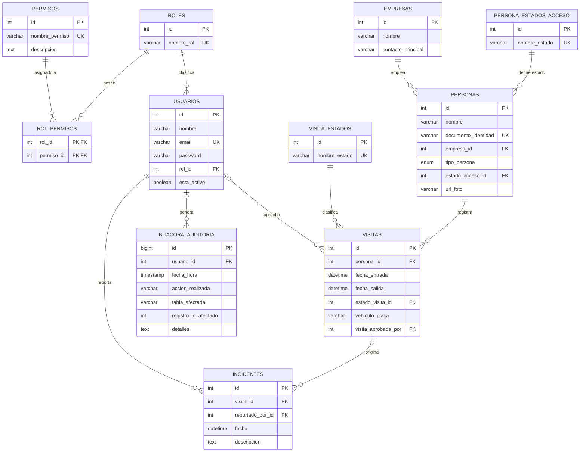

# SICA — Sistema Integrado de Control de Acceso para Zona Acme

## 1. Introducción

**Zona Acme** es un complejo empresarial con más de 30 empresas. Su control de acceso se apoyaba en libros de registro en papel y radio: no se sabía quién estaba dentro en un momento dado, las visitas no anunciadas bloqueaban la recepción y reconstruir un incidente era una tarea manual e imprecisa.

**SICA** sustituye ese proceso por una aplicación de escritorio que centraliza:

- Registro de personas, empresas, usuarios y roles con **RBAC dinámico** leído desde MySQL.
- **Cuatro flujos de acceso** (pre-registrado, no anunciado, carnet olvidado y salida olvidada) con aprobaciones **en tiempo real** entre ventanas independientes.
- **Bitácora de auditoría inmutable** de cada operación crítica.
- Reportes de "quién está dentro", historial de visitas e incidentes.

### Stack tecnológico

| Capa | Tecnología | Uso en SICA |
|---|---|---|
| Lenguaje | **Java SE 17** | Sin Spring ni frameworks pesados; Streams, lambdas, records y `ScheduledExecutorService`. |
| UI | **Swing + FlatLaf 3.5.4** | Look & Feel moderno: botones redondeados, tablas limpias, tema claro/oscuro. |
| Seguridad | **jbcrypt 0.4** | Hash BCrypt (coste 10) de contraseñas con salt automático. |
| Persistencia | **MySQL Connector/J 8.4.0** | JDBC directo, `PreparedStatement` y transacciones. |
| Base de datos | **MySQL 8.0 + phpMyAdmin** | Docker Compose, volumen persistente y carga automática de SQL. |
| Build | **Maven 3.9+** | `pom.xml`, perfiles de compilación, ejecución y pruebas. |
| Pruebas | **JUnit Jupiter 5.10.2** | 15 pruebas unitarias de reglas de negocio (`scope test`). |

> No hay ORM, IOC ni "magia": las dependencias se inyectan a mano en `ServiceLocator`.

> **Codificación:** todos los archivos de texto del repositorio están en **UTF‑8 sin BOM** y con saltos de línea `LF` (ver `.gitattributes`). El README original del proyecto era UTF‑16LE; se normalizó para que Git lo trate como texto y los diffs sean legibles.

---

## 2. Arquitectura del proyecto

### 2.1 Árbol de directorios

```
project-sica/
├── pom.xml                       # Java 17, dependencias y plugins (jar / exec / surefire)
├── docker-compose.yml            # MySQL 8.0 + phpMyAdmin + volumen persistente
├── db/
│   ├── schema.sql                # 11 tablas del PDF + índices de apoyo
│   └── data.sql                  # Permisos, roles, 4 usuarios, looks y visitas de prueba
├── src/main/
│   ├── resources/
│   │   └── application.properties # URL JDBC, credenciales y seconds de refresco
│   └── java/com/zonaacme/sica/
│       ├── SicaApplication.java   # main(): instala FlatLaf, prueba BD, abre LoginFrame
│       ├── config/                # AppSettings, DatabaseConfig (Singleton), ServiceLocator
│       ├── model/
│       │   ├── entity/            # Usuario, Rol, Permiso, Persona, Empresa, Visita,
│       │   │                      # Incidente, BitacoraAuditoria, Sesion
│       │   └── enums/             # EstadoVisita, EstadoAcceso, TipoPersona,
│       │                          # TipoFlujoVisita, AccionAuditoria
│       ├── dao/                   # Contratos + BaseDao, RowMapper, TransactionRunner
│       │   └── impl/              # Implementaciones JDBC (una por entidad)
│       ├── service/               # Interfaces de negocio (una por caso de uso)
│       │   └── impl/              # Reglas RBAC, auditoría, flujos y transacciones
│       ├── pattern/               # factory/, observer/, strategy/ (los 3 patrones de comportamiento)
│       ├── controller/            # SicaController (fachada) y NavegacionController
│       ├── view/                  # LoginFrame, MainFrame
│       │   ├── components/        # UiTheme, BasePanel, GenericTableModel, EstadoRenderer, Formularios
│       │   └── panels/            # ControlAcceso, Personas, Empresas, Usuarios, Incidentes, Reportes
│       ├── util/                  # PasswordHasher, ValidationUtil, DateUtil
│       └── exception/             # SicaException + AccesoDenegado, Validacion, Persistence
└── src/test/java/com/zonaacme/sica/  # Pruebas JUnit de estrategias, factory, RBAC y hash
```

### 2.2 Flujo de comunicación entre capas

```
Clic en Swing (view/panels/*)
        │  solo eventos y componentes; sin SQL ni reglas de negocio
        ▼
SicaController.ejecutar(Accion)  (controller)
        │  traduce excepciones a Resultado(ok, mensaje)
        ▼
XxxServiceImpl  (service)
        ├── sesion.requerir("permiso")          → RBAC en servidor
        ├── IngresoStrategyResolver / VisitaFactory / VisitaEventBus
        ├── AuditoriaService.registrar(...)     → bitácora
        ▼
XxxDao (interfaz) → XxxDaoJdbc extends BaseDao (dao)
        │  PreparedStatement + try-with-resources
        ▼
DatabaseConfig (Singleton) → DriverManager → MySQL 8.0 (Docker)
```

**Regla MVC:** la vista nunca escribe SQL. Llama al controlador, recibe un `Resultado` y muestra un `JOptionPane`. La lógica de negocio vive en `service`, y el acceso a datos en `dao`.

### 2.3 Actualización en tiempo real (multi-ventana)

1. `ServiceLocator` es un Singleton que crea **una sola** instancia de `VisitaEventBus` y la comparte entre todas las ventanas.
2. Cada `BasePanel` se suscribe al bus en `addNotify()` y se desuscribe en `removeNotify()`.
3. Cuando un servicio aprueba, rechaza, hace check-in/out o regulariza una salida, llama a `eventos.notificar(tipo, mensaje)`.
4. `VisitaEventBus.notificar()` usa `CopyOnWriteArrayList` y envía cada callback al **EDT** con `SwingUtilities.invokeLater`; el panel vuelve a consultar la BD y repinta su tabla.
5. Además, `BasePanel` programa un `ScheduledExecutorService` con `AppSettings.refreshSeconds()` (2 s por defecto) como red de seguridad si una ventana se abre después del cambio.

**Resultado:** se pueden abrir dos sesiones con el botón **"＋ Nueva ventana"** (Guarda y Funcionario) y ver la aprobación del Funcionario reflejada en la bandeja del Guarda sin reiniciar.

---

## 3. Modelo de base de datos

### 3.1 Diagrama Entidad-Relación (Mermaid)



### 3.2 Grupos de tablas

| Grupo | Tablas | Propósito |
|---|---|---|
| **RBAC** | `roles`, `permisos`, `rol_permisos`, `usuarios` | Los 25 permisos viven en la BD. Al hacer login se cargan los nombres del rol y se guardan en `Sesion`; la UI muestra solo módulos permitidos y el servicio vuelve a validar con `sesion.requerir(...)`. |
| **Lookups** | `persona_estados_acceso`, `visita_estados` | Catálogos de estados. Además de los estados del PDF se añaden los ids 7 y 8 (`Pendiente de Aprobacion por Olvido`, `Cerrada por Sistema (Salida Olvidada)`) que exigen los flujos 3 y 4; el propio documento indica "etc.". |
| **Operacionales** | `empresas`, `personas`, `visitas`, `incidentes` | Personas (trabajadores/invitados), visitas con su estado y trazabilidad de aprobación, e incidentes asociados a una visita. |
| **Auditoría** | `bitacora_auditoria` | Solo INSERT desde servicios y SELECT desde la UI. Registra quién, cuándo, qué acción, tabla, registro y detalle. No hay UPDATE/DELETE en el código: es inmutable por diseño. |

> El esquema respeta columnas y relaciones del documento; los índices (`idx_visitas_persona`, `idx_visitas_estado`, `idx_bitacora_fecha`, …) son apoyo de consulta y no alteran el modelo.

---

## 4. Decisiones de diseño: SOLID y patrones

### 4.1 Principios SOLID

| Principio | Dónde está | Por qué se decidió así |
|---|---|---|
| **SRP** — Responsabilidad única | `VisitaServiceImpl`, `AppSettings`, `BaseDao`, `VisitaEventBus` | Cada clase hace una sola cosa: orquestar accesos, leer configuración, ejecutar JDBC o notificar eventos. Un cambio en el tema visual no toca la lógica de visitas. |
| **OCP** — Abierto/Cerrado | `IngresoStrategyResolver` + `IngresoStrategy`; `VisitaFactory` | Un nuevo flujo se agrega como nueva estrategia/entrada del mapa sin modificar el servicio. El servicio solo conoce al resolvedor. |
| **LSP** — Sustitución de Liskov | `UsuarioDao` → `UsuarioDaoJdbc`, `VisitaSubject` → `VisitaEventBus` | Cualquier implementación del contrato puede sustituirse sin cambiar los servicios que la consumen. |
| **ISP** — Segregación de interfaces | `VisitaObserver`, `RowMapper`, `Accion`, servicios separados (`AuthService`, `AuditoriaService`, …) | Interfaces pequeñas: un panel solo implementa `onVisitasActualizadas`, no todos los eventos posibles. |
| **DIP** — Inversión de dependencias | Servicios → interfaces DAO; `ServiceLocator` inyecta las implementaciones | La capa de negocio no importa `*.dao.impl`; depende de abstracciones. `ServiceLocator` es el único lugar que "sabe" qué implementación se usa. |

### 4.2 Los 5 patrones clásicos (exactamente)

| # | Patrón | Clases participantes | Problema que resuelve en SICA |
|---|---|---|---|
| 1 | **Singleton** | `DatabaseConfig` (holder thread-safe) y `ServiceLocator` (composition root) | Un único punto de configuración JDBC y un único `VisitaEventBus` compartido por todas las ventanas. *`ServiceLocator` no cuenta como patrón nuevo: es otra aplicación del mismo Singleton.* |
| 2 | **DAO** | `BaseDao`, `RowMapper`, interfaces `XxxDao` y sus `XxxDaoJdbc` | Aísla JDBC (try-with-resources, parámetros, transacciones) del negocio y permite sustituir la persistencia sin tocar los servicios. |
| 3 | **Factory** | `VisitaFactory` + `TipoFlujoVisita` | Centraliza la creación de `Visita` según el flujo, asignando estado inicial, aprobador y fecha de entrada. Evita `if/else` repartidos por el servicio. |
| 4 | **Observer** | `VisitaSubject`, `VisitaObserver`, `VisitaEventBus`, `BasePanel` | La aprobación del Funcionario actualiza al instante la bandeja del Guarda, sin polling manual ni reinicio. Los callbacks se entregan en el EDT de Swing. |
| 5 | **Strategy** | `IngresoStrategy`, 5 estrategias concretas, `IngresoStrategyResolver`, `SolicitudIngreso`, `ResultadoIngreso` | Encapsula cada regla (bloqueado, salida olvidada, pre-registrado, no anunciado, carnet olvidado) y las aplica en orden de prioridad con un `stream().map(...).filter(...).findFirst()`. |

> **Nota de sustentación:** los 5 patrones están etiquetados en el Javadoc de las clases. `ServiceLocator` es intencionalmente el mismo Singleton #1, para no introducir un sexto patrón.

---

## 5. Instalación y ejecución

### 5.1 Prerrequisitos

- **JDK 17+** (verificado con Eclipse Temurin 17.0.21).
- **Maven 3.9+** en el `PATH` (`mvn -version`).
- **Docker Desktop** en ejecución con `docker compose` disponible.

### 5.2 Levantar la base de datos

```bash
# Desde la raíz del proyecto
docker compose up -d

# Esperar a que MySQL esté sano y verificar que las 11 tablas se crearon
docker compose exec sica-mysql mysql -uroot -proot1234 \
  -e "USE sica_db; SHOW TABLES; SELECT COUNT(*) AS permisos FROM permisos; SELECT * FROM roles;"
```

Resultado esperado: 11 tablas, 25 permisos y 4 roles.

| Servicio | Dirección | Credenciales |
|---|---|---|
| MySQL 8.0 | `localhost:3307` | usuario `sica_user` / contraseña `sica_pass` (root: `root1234`) |
| phpMyAdmin | <http://localhost:8081> | `sica_user` / `sica_pass` o `root` / `root1234` |

> Usamos el puerto **3307** en el equipo host para no chocar con un MySQL local ya instalado (muy común en Windows). Dentro del contenedor MySQL sigue escuchando en 3306 y phpMyAdmin se conecta por la red interna de Docker. Si en tu PC no hay MySQL local, también funciona igual.

> Los scripts `db/schema.sql` y `db/data.sql` se montan en `/docker-entrypoint-initdb.d` y se ejecutan **solo la primera vez** que se crea el volumen `sica_mysql_data`. Para reiniciar los datos: `docker compose down -v && docker compose up -d`.

### 5.3 Compilar y ejecutar

```bash
# Opción A: ejecutar con Maven (la más sencilla)
mvn clean package
mvn exec:java

# Opción B: jar ejecutable
mvn clean package
mvn dependency:copy-dependencies -DoutputDirectory=target/lib
java -jar target/sica-1.0.0.jar

# Pruebas unitarias
mvn test
```

Si MySQL no está disponible, la aplicación muestra un aviso indicando la URL JDBC; la ventana de login se abre igual para que se vea el mensaje de error al intentar ingresar.

---

## 6. Guía de uso y pruebas de los 4 flujos

### 6.1 Credenciales de prueba

Contraseña para **los cuatro usuarios**: `Acme2024!` (guardada como hash BCrypt).

| Rol | Correo | Permisos principales |
|---|---|---|
| Superusuario | `superusuario@zonaacme.com` | Todos (25), incluidos usuarios, roles/permisos y bitácora |
| Supervisor de Seguridad | `supervisor@zonaacme.com` | Personas, control de acceso, incidentes, reportes y auditoría |
| Guarda de Seguridad | `guarda@zonaacme.com` | Ver personas/empresas, registrar visitas, check-in/out, incidentes |
| Funcionario de Empresa | `funcionario@globex.com` | Crear/editar personas, pre-registrar, aprobar/rechazar, reportes |

### 6.2 Preparar las dos ventanas simultáneas

1. Ingrese como **Funcionario** (`funcionario@globex.com`).
2. En la cabecera haga clic en **"＋ Nueva ventana"**.
3. En la nueva ventana ingrese como **Guarda** (`guarda@zonaacme.com`).
4. Ambas ventanas comparten el mismo `VisitaEventBus`: cualquier cambio en una aparece en la otra en ≤ 2 segundos.

### 6.3 Flujo 1 — Invitado pre-registrado

1. En la ventana del **Funcionario**, módulo *Control de Acceso*, busque `20000002` (Mario Invitado). Ya existe una visita `#1` en estado **Aprobado**.
2. Para crear uno nuevo: **Nueva persona** → complete datos → **Pre-registrar invitado**. La visita nace en estado **Aprobado** (`VisitaFactory`).
3. En la ventana del **Guarda**, busque el documento, abra la pestaña **"Aprobadas · pendientes de ingreso"** y haga clic en **Registrar check-in**.
4. La visita pasa a **Dentro** y aparece en la pestaña *Dentro ahora*. Registre el **check-out** para cerrarla.

### 6.4 Flujo 2 — Invitado no anunciado (tiempo real)

1. En la ventana del **Guarda**, busque `20000005` (Laura Invitada) y haga clic en **Registrar no anunciado**.
2. La visita queda en **Pendiente de Aprobacion** y se emite el evento `NUEVA_SOLICITUD`.
3. En la ventana del **Funcionario**, la pestaña **"Solicitudes pendientes"** muestra la nueva fila y la barra inferior indica el evento recibido.
4. Haga clic en **Aprobar**. El Guarda ve cómo la fila desaparece de *Pendientes* y aparece en *Aprobadas* **sin recargar**.
5. El Guarda realiza el check-in. (También puede probar **Rechazar**.)

### 6.5 Flujo 3 — Trabajador con carnet olvidado

1. En la ventana del **Guarda**, busque `10000007` (Carlos Trabajador) y haga clic en **Pase por carnet olvidado**.
2. La visita queda en **Pendiente de Aprobacion por Olvido** (estado 7) y notifica al Funcionario.
3. El **Funcionario** aprueba la solicitud en su bandeja: se registra `visita_aprobada_por` y el evento `APROBADA`.
4. El **Guarda** hace check-in desde *Aprobadas · pendientes de ingreso*: es un pase válido solo para ese día.

### 6.6 Flujo 4 — Salida olvidada (regularización automática)

1. En `data.sql` la persona `10000003` (Sara Trabajadora) ya tiene la visita `#2` en estado **Dentro** desde hace dos horas.
2. En la ventana del **Guarda**, busque `10000003` y registre un nuevo ingreso (por ejemplo **Registrar no anunciado**).
3. La estrategia `SalidaOlvidadaStrategy` detecta la visita abierta **antes** que cualquier otra regla. `VisitaServiceImpl.regularizarSalidaOlvidada()` ejecuta en **una transacción**:
   - cierra la visita `#2` como **Cerrada por Sistema (Salida Olvidada)**;
   - crea la nueva visita en estado **Dentro** con fecha de entrada;
   - inserta 3 filas de auditoría (`CIERRE_AUTOMATICO_VISITA`, `REGISTRO_VISITA`, `CHECK_IN`).
4. El sistema **no bloquea** el paso: la persona entra con la nueva visita.
5. Ingrese como **Superusuario** y compruebe en *Reportes y Auditoría* → pestaña *Historial de visitas* y *Bitácora de auditoría* que todo quedó registrado.

### 6.7 Verificación rápida de auditoría

```bash
docker compose exec sica-mysql mysql -uroot -proot1234 -e \
  "USE sica_db; SELECT accion_realizada, tabla_afectada, fecha_hora FROM bitacora_auditoria ORDER BY id DESC LIMIT 20;"
```

Cada login (exitoso o fallido), alta/edición/baja de usuarios, personas y empresas, cambio de estado de acceso, aprobación, check-in, check-out e incidente debe aparecer allí.

---

## 7. Resumen para la sustentación

> **Hoja de bolsillo:** comandos, credenciales y respuestas cortas en [`docs/GUIA-SUSTENTACION.md`](docs/GUIA-SUSTENTACION.md).

- **Una capa, una responsabilidad:** Swing → `SicaController` → `service` → `dao` → MySQL; la vista jamás toca SQL.
- **RBAC en dos lugares:** la UI oculta módulos y el servicio vuelve a validar con `sesion.requerir("permiso")`.
- **Tiempo real sin frameworks:** `VisitaEventBus` + `SwingUtilities.invokeLater`, reforzado con `ScheduledExecutorService`.
- **Transacciones reales:** la salida olvidada usa `TransactionRunner` para garantizar "todo o nada".
- **Cinco patrones, ninguno de relleno:** Singleton, DAO, Factory, Observer y Strategy, cada uno con una clase y un problema concreto.
